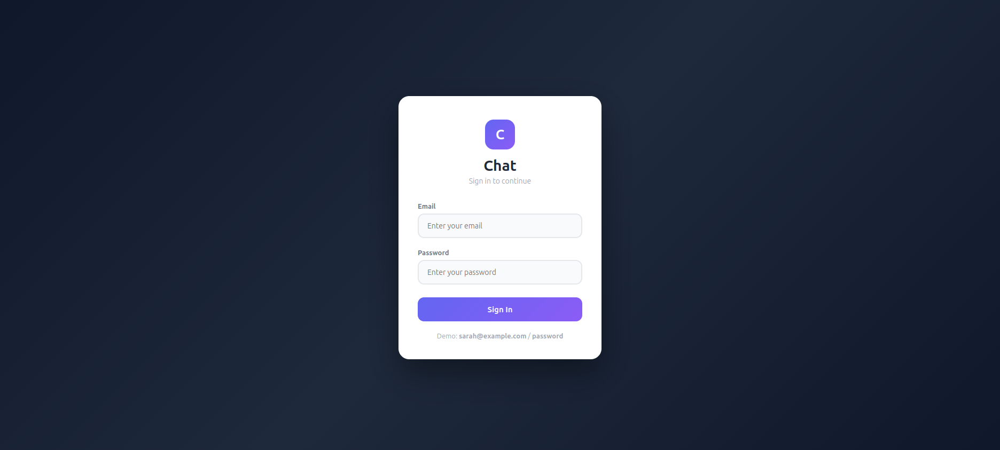
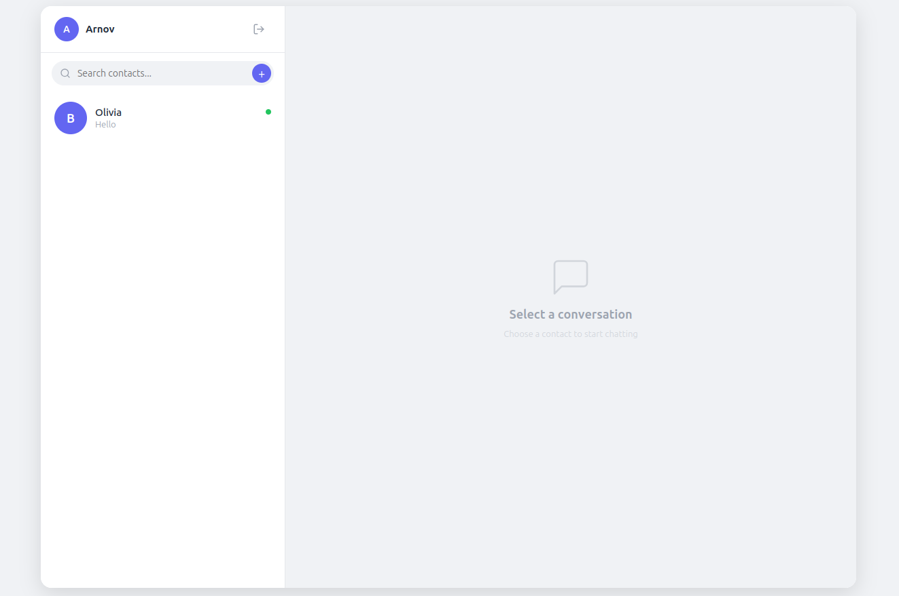
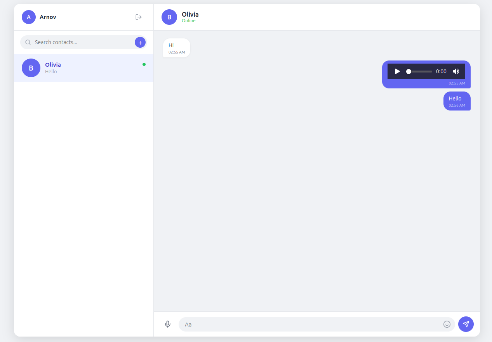

# Chat App

[](https://www.php.net)
[](https://mariadb.org)
[](https://nginx.org)
[](https://www.docker.com)
[](https://developer.mozilla.org/en-US/docs/Web/JavaScript)
[](./ChatDroid)
[](https://en.wikipedia.org/wiki/Advanced_Encryption_Standard)
[](.)

A real-time chat application built with the Lime PHP Framework, featuring text and encrypted voice messaging.

## Features

- **User Authentication** — Login/logout with session-based auth, bcrypt password hashing
- **Contact Management** — Add contacts by email, bidirectional friendship
- **Text Messaging** — Real-time message sending with 5-second incremental polling (only new messages fetched)
- **Voice Messaging** — Record and send voice messages via MediaRecorder API
- **Encrypted Voice Storage** — All voice files encrypted at rest with AES-256-CBC using a server-side key
- **Access‑Controlled Files** — Voice messages served through PHP with authorization checks (only sender/receiver can access)
- **Contact‑Only Chat** — Only confirmed contacts appear in the sidebar
- **Responsive UI** — Modern design with sidebar, search, and message bubbles

## Screenshots

| Login | Chat | Voice Chat |
|-------|------|------------|
|  |  |  |

## Tech Stack

| Layer | Technology |
|-------|-----------|
| Framework | Lime PHP Framework (custom MVC) |
| Language | PHP 8.5 |
| Server | Nginx (Alpine) |
| Database | MariaDB 10.11 |
| Frontend | Vanilla JS, CSS |
| Validation | vlucas/valitron |

## Quick Start

```bash
docker compose up -d
docker compose exec chat_app php lime migrate
```

Open http://localhost:8085

### Demo Credentials

| Email | Password |
|-------|----------|
| sarah@example.com | password |
| mike@example.com | password |

## Project Structure

```
├── App/
│   ├── Controller/     # AuthController, ChatController
│   ├── Database/
│   │   └── Migrations/ # SQL migrations (users, messages, contacts, seeds)
│   ├── Router/
│   │   └── web.php     # Route definitions
│   └── View/
│       ├── auth/       # Login page
│       └── chat/       # Chat messenger
├── Public/
│   ├── index.php       # Entry point
│   └── styles.css
├── System/             # Lime framework core
├── storage/voice/      # Encrypted voice files (outside web root)
├── docker-compose.yml
└── .env                # APP_KEY for encryption
```
